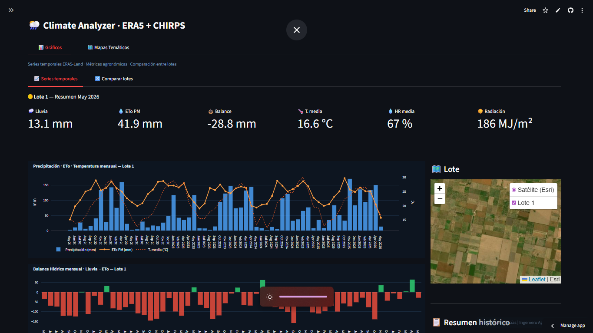
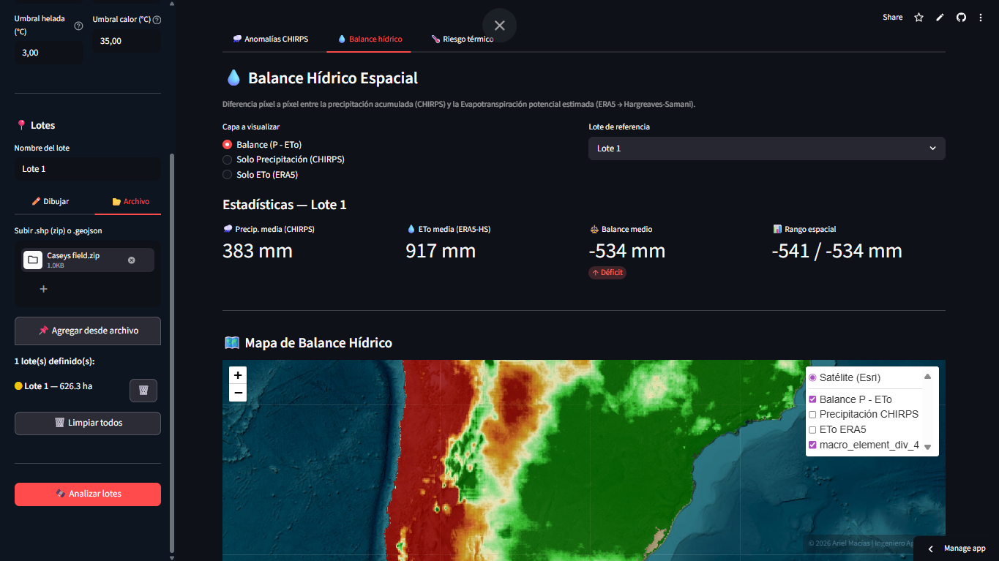
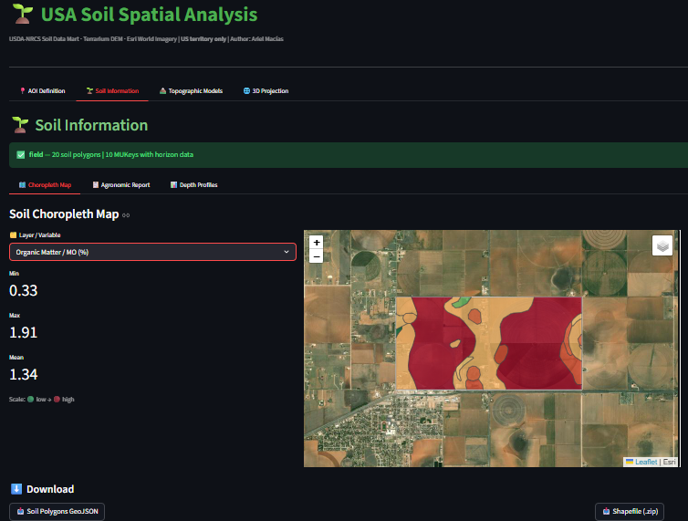
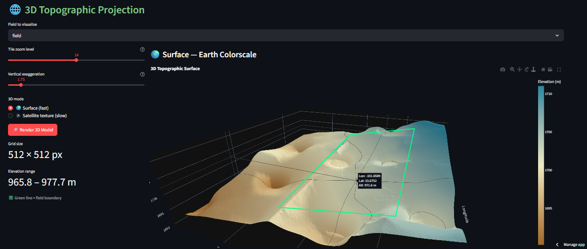
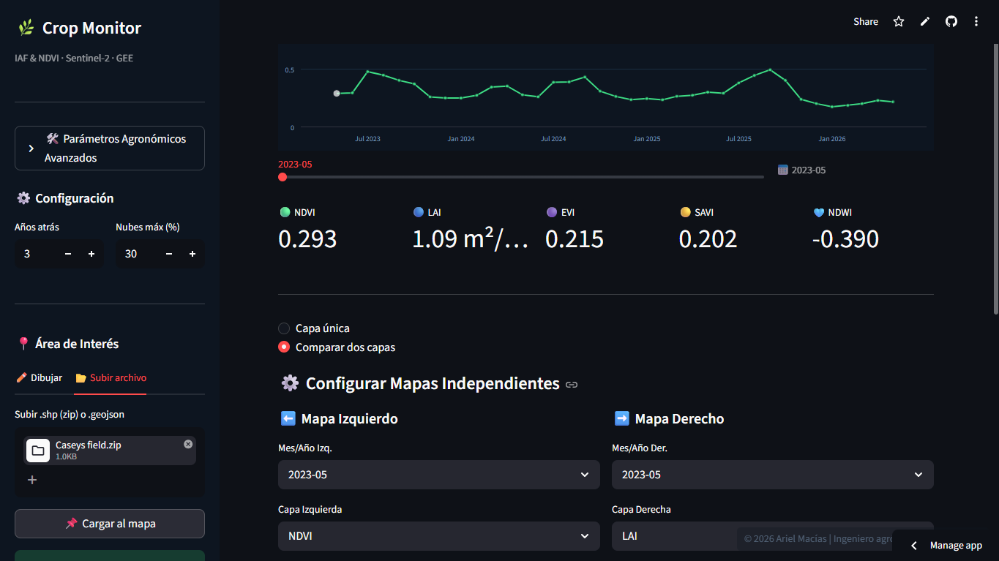
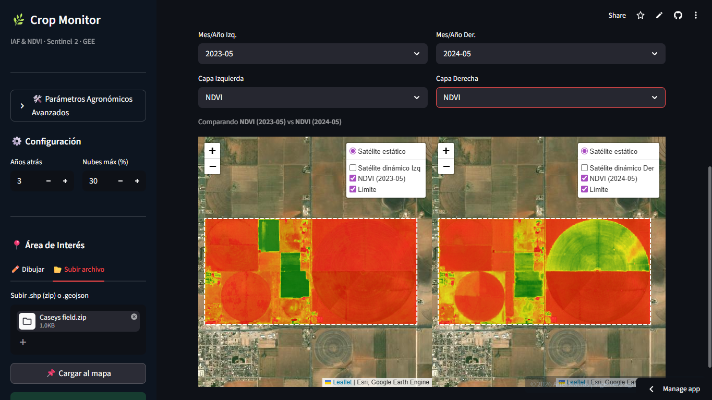

# AgTech & GeoSpatial Data Science Portfolio

**Turning spatial and climate data into intelligent agronomic solutions.**

I am an **Agronomist (Agricultural Engineer)** and **GIS Analyst**, specialized in translating complex agronomic needs into automated workflows (*pipelines*) and minimum viable products (MVPs).

---

## Featured Projects

## 🌦️ [AgroClimatic Data Pipeline](https://github.com/Amaciasagro/GIT-RemoteSensing/blob/master/02_Climate_Analyzer/README.md)
Automated Python engine for extracting and processing satellite-derived climate variables.
* **Technologies:** Google Earth Engine (GEE), Python (Pandas, Shapely).
* **Impact:** Implementation of a hybrid algorithmic model (ERA5 + CHIRPS) that improves the accuracy of reference evapotranspiration (Penman-Monteith ETo) and water balance calculations at field scale.

### Statistical analysis
* 

### Thematic maps
* 

---
---

## 🗺️ [Soils Spatial Analysis Module](https://github.com/Amaciasagro/GIT-RemoteSensing/blob/master/01_USA_Soils_analysis/README.md)
Vector geoprocessing and advanced spatial analysis workflow for soil cartography.
* **Technologies:** GeoPandas, Matplotlib, soil data APIs.
* **Impact:** Automated query system and structured soil databases (integrating U.S. data). Facilitates the visualization and export of key variables for territorial diagnosis and environment classification.

### Thematic maps by attribute  
* 

### 3D topographic projection
* 

---
---

## 🌱 [Crop Remote Sensing Models](https://github.com/Amaciasagro/GIT-RemoteSensing/blob/master/03_CropMonitor/README.md)
Analytical modules for phenological monitoring and biomass estimation through remote sensing.
* **Technologies:** Python, multispectral band processing.
* **Impact:** Large-scale calculation of vegetation indices (NDVI, NDWI, EVI, SAVI) and Leaf Area Index (LAI) modeling for early anomaly detection and productivity characterization.

### Vegetation index calculation and interactive curve  
* 

### Comparison between one or more fields  
* 

---
---

## 🛠️ Tech Stack

* **Languages & Environments:** Python (Advanced), Jupyter Notebooks, VS Code (Local), Google Colab (Cloud).
* **Data Science & GIS:** GeoPandas, GEE API, Pandas, Shapely, QGIS.
* **Visualization:** Matplotlib, Folium, Streamlit, Plotly.
* **Version Control:** Git & GitHub (collaborative development and code versioning).

---

## 🎓 Education & Certifications
* **Agricultural Engineer** (Faculty of Agricultural Sciences - UNNE // Corrientes, Argentina).
* **GIS Analyst Assistant** (Instituto Superior Escuela de Robótica e Inglés // Misiones, Argentina).
* **Fundamentals of Remote Sensing** (ARSET - NASA).
* **Data Analysis with Python for Agriculture** (UNC).

---

## 📬 Contact
* **Location:** Forest Lake, MN, USA (Available for remote projects).
* **LinkedIn:** [Ariel Macías](https://www.linkedin.com/in/ariel-macías-509b0718a)
* **Email:** amacias.agro@gmail.com
